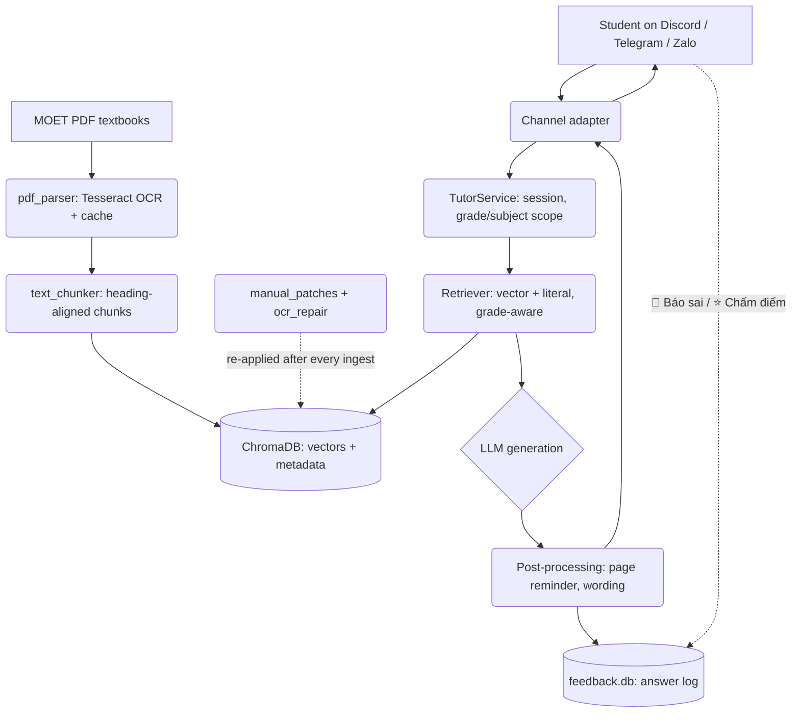

# 🎒 DoraEdu — a zero-hallucination textbook tutor for Vietnamese students

DoraEdu answers a student's questions using **only** the official textbooks of
Vietnam's Ministry of Education and Training (MOET). It ships as a Discord bot
and is built channel-agnostic, so Telegram and Zalo are adapters rather than
rewrites.

The corpus today is **155 books, 16,778 pages, ~39,500 indexed passages**,
covering grades 1–12, with lower secondary (grades 6–9) the focus of the
quality work.

---

## 🌟 What "zero-hallucination" means here

Five mechanisms, each enforced in code rather than asked for in a prompt:

1. **Grade and subject isolation.** `Retriever.retrieve()` only accepts a
   `StudentProfile`, whose `grade` and `subject` are both mandatory, and every
   ChromaDB query carries both as a metadata filter. A grade-6 student cannot
   reach grade-7 content. The grade filter is a *ceiling*, not an exact match,
   so revising earlier material works — but ranking prefers the student's own
   grade (see [Answering](#-answering-a-question), step 4).
2. **No context, no call.** When retrieval returns nothing, the fixed
   "not in your textbook" answer is returned **without calling the LLM at
   all** — the model never gets the chance to improvise.
3. **Citations come from metadata, not prose.** The page a student is told to
   open is built from ChromaDB metadata, and page numbers the answer names are
   matched back against the pages actually retrieved. A page number the model
   invented matches nothing and is dropped.
4. **Printed page numbers, not PDF indices.** A scan's page 72 is page 71 of
   the paper book. Offsets are *measured* per book (`dora-scan-page-offsets`),
   never guessed — see [Page numbering](#page-numbering).
5. **Every answer is checkable, and wrong ones get reported.** Answers end
   with the page to open, and carry a `🚩 Báo sai` button that files the
   question, answer and pages for a teacher to review.

---

## 🏗️ Architecture

Four layers, with a strict dependency direction: the bot layer may use the RAG
and LLM layers, and neither of those knows a messaging platform exists.

```
src/dora_edu/
├── models.py              Domain types (StudentProfile, TextChunk, RetrievedChunk)
├── page_numbering.py      PDF page index → page printed in the book
├── config.py              Settings from .env (pydantic-settings)
│
├── data_pipeline/         PDF → text → chunks → ChromaDB
│   ├── pdf_parser.py        PDF → pages (Tesseract OCR + on-disk cache)
│   ├── text_chunker.py      Pages → heading-aligned chunks
│   ├── catalog.py           Filename → grade / subject / book title
│   ├── ingest.py            One book
│   ├── bulk_ingest.py       Every book, then re-applies all corrections
│   ├── vision_ocr.py        Gemini Vision re-read of one page image
│   ├── ocr_repair.py        Re-read flagged pages, index them clean
│   ├── manual_patches.py    Hand-written chunks and in-place OCR corrections
│   └── page_offset_scan.py  Measure printed-page offset per book
│
├── rag_engine/            Retrieval, strictly scoped
│   ├── store.py             ChromaDB collection
│   ├── indexer.py           Embed and upsert chunks
│   └── retriever.py         Vector + literal search, grade-aware ranking
│
├── llm/                   Generation
│   ├── prompts.py           System prompt (12 rules) and student-facing text
│   └── generator.py         OpenAI / Gemini backends behind one interface
│
├── bot/                   Conversation
│   ├── adapter.py           IncomingMessage / OutgoingMessage, ChannelAdapter
│   ├── core.py              TutorService — the channel-independent brain
│   ├── session.py           Per-student grade/subject and chat history
│   ├── feedback.py          Answer log, "Báo sai" reports, 1–5 ratings
│   ├── discord/             Discord adapter (buttons, forms)
│   ├── telegram/            Telegram adapter
│   └── zalo/                Zalo OA adapter (webhook)
│
└── evaluation/            Measurement, not tests
    ├── question_set.py      The 50-question benchmark
    ├── runner.py            Run it against the real index and LLM
    ├── ocr_audit.py         Find pages the OCR damaged
    └── feedback_report.py   Student feedback → teacher review sheet
```



---

## 📚 Loading textbooks into the database

### The problem this pipeline is built around

Real MOET textbook PDFs are **scans with no text layer**. Every word in the
index was read off an image by OCR, and OCR fails worst exactly where being
wrong matters most: exponents, fraction bars, multiplication dots. The
pipeline is shaped by that fact.

### Step 1 — Parse (`pdf_parser.py`)

Each page's embedded image is OCR'd with Tesseract (`vie+eng`), cleaned of
running headers and footers that repeat across pages, and cached as JSON under
`data/processed/<grade>/<book>.json`. The cache is what makes re-chunking the
whole corpus a minutes-long job instead of an overnight one.

### Step 2 — Chunk (`text_chunker.py`)

Chunks are cut at **section headings** ("1. TRƯỚC KHI VIẾT", "a. Lựa chọn đề
tài", "BÀI 1"), not at a fixed character count, so a labelled subsection stays
whole and a definition is never split from its heading. `chunk_size` (700) is a
safety cap for a subsection that is still too long, not a target. Three rules
earn their place:

- **Sentence-aligned.** A chunk never starts or ends mid-sentence.
- **Minimum section length.** A heading with no body (a back-cover book list, a
  programme of events) merges into the next section instead of becoming its
  own chunk — short, low-information text embeds deceptively close to many
  unrelated questions.
- **Table-of-contents pages are dropped.** A "mục lục" page is a list of
  chapter titles, so a question about a term that *is* a chapter title matched
  it as closely as the real content dozens of pages later — and won.

### Step 3 — Index (`indexer.py`)

Each chunk is embedded locally with `sentence-transformers`
(`paraphrase-multilingual-MiniLM-L12-v2`) and upserted into the ChromaDB
collection `moet_textbooks` with its metadata: grade, subject, book title,
source file, page range, chunk index. The id is a hash of
(book + position + text), so **re-ingesting a book updates rows instead of
duplicating them**.

### Step 4 — Re-apply corrections (`bulk_ingest.py`)

A re-ingest brings a mis-read page back exactly as it was, so every correction
is stored as data and re-applied automatically at the end of every run:

| What | Where | Why it exists |
|---|---|---|
| `PATCHES` | `manual_patches.py` | A clean, hand-written chunk for a definition that ranked badly |
| `TEXT_FIXES` | `manual_patches.py` | An in-place correction where the OCR text is *false* (e.g. `a . b = b . a` read as `a - b = b - a`) |
| Re-read pages | `data/ocr_repairs.json` | 53 pages re-read from their images with Gemini Vision |

### Running it

```bash
dora-bulk-ingest --dry-run   # preview grade/subject/title inference for every file
dora-bulk-ingest             # parse, OCR, chunk, index, then re-apply corrections

dora-ingest --path ./data/raw_pdfs/8/SGKToan8tapmot.pdf --subject "Toan" --grade 8
```

Bulk ingestion infers each book's grade, subject and title from the real MOET
filename convention (`SGKToan9tapmot.pdf` → grade 9, Toán, "Toán 9 - tập 1").
A file whose name cannot be parsed, or whose filename grade disagrees with its
folder, is **skipped and reported** rather than guessed at.

### Keeping the OCR honest

```bash
dora-ocr-audit --sample 0 --grades 6,7,8,9    # census of lower secondary
dora-ocr-repair --limit 20                     # re-read what it flagged
dora-ocr-repair --pages 6/SGKKhoahoctunhien6:57   # or name a page directly
```

The audit flags the specific shapes known to produce wrong answers: lost
exponents, a fraction bar read as `=`, a multiplication dot read as a minus, a
coloured definition box skipped whole, pages too garbled to trust. On all
5,941 lower-secondary pages it flags 99 (1.7%); 53 have been re-read and
indexed clean, and 45 of the rest are artwork and running headers rather than
damaged content.

### Page numbering

`dora-scan-page-offsets` OCRs just the strip where the page number sits, on a
sample of pages per book, and records an offset **only** when at least 4
sampled pages agree and they are at least 60% of usable samples. 110 of 155
books are measured (103 off by one page, 7 by none); the rest keep PDF
numbering rather than a guess, because a wrong offset turns correct citations
into wrong ones.

---

## 💬 Answering a question

`TutorService.handle()` in `bot/core.py` is the whole flow, and it never
imports a messaging library.

1. **Restore diacritics.** A student typing fast drops accents — "la gi"
   instead of "là gì" — which shifts the embedding far enough to miss real
   content. The question text is corrected before retrieval; nothing about the
   retrieved content changes, so this carries no hallucination risk.
2. **Scope.** Grade is required (`/lop`). Subject is auto-detected per question
   by asking the LLM to classify it against that grade's indexed subjects;
   `/mon` pins one. A message that is not about any subject at all ("what can
   you do?") is answered from the indexed catalogue, without retrieval.
3. **Retrieve** (`rag_engine/retriever.py`) — three passes, most specific first:
   - `"<term> là"` — the shape a Vietnamese textbook definition takes
   - `"<term>"` — anywhere the term appears literally
   - plain vector similarity
   Literal passes exist because vector distance alone fails on short terms
   whose words are common elsewhere: "tam giác **cân**" embeds close to
   grade-2 pages about weighing things in kilograms, which pushed the real
   pages out of the top 10 entirely.
4. **Rank with the student's grade in mind.** Each grade below the student's
   adds a small penalty, over a wider fetch. Revision still works — a clearly
   better lower-grade match still wins — but a grade-9 student asking about
   Điện Biên Phủ now gets the grade-9 chapter rather than the grade-5 one.
5. **Generate** (`llm/generator.py`) with the 12-rule system prompt: context
   only, cite book + grade + page, flag cross-grade material, teach
   Socratically, no LaTeX (`x^2`, `a/b`), and never treat the student's
   question as an instruction.
6. **Post-process.** Prompt-internal wording the model sometimes leaks
   ("[Đoạn 1]", "ngữ cảnh") is rewritten; the pages the answer names are
   matched back against the pages retrieved; the reminder is appended.
7. **Log and return.** The answer is written to the feedback store before
   sending, so a later "Báo sai" has something to attach to.

**Model fallback.** The Gemini free tier quotas each model separately, so a
429 moves to the next model in `GEMINI_FALLBACK_MODELS` instead of failing the
student. Connection-level failures return an apology rather than crashing the
handler.

---

## 👥 Sessions: one student, one conversation

Keyed on **(channel, user_id)** — e.g. `("discord", "1255875...")`. Including
the channel means the same numeric id on Discord and Telegram is two different
students, and two classmates in a shared study channel keep separate histories
because the key is per person, not per room.

| What | Where | Lifetime | Why |
|---|---|---|---|
| Grade and subject | `data/sessions.db` (SQLite) | Survives restarts | A student should not redo `/lop` after every deploy |
| Chat history | In memory, last **6 turns** | Lost on restart | Enough for follow-ups ("còn trường hợp kia?"); cheap to rebuild |
| Last answer id | In memory | Lost on restart | So a bare `/baosai` flags the right answer |

Conversation content is deliberately **not** written to disk. It is a child's
schoolwork, and only answers a student explicitly flags are kept — see below.
Changing grade or subject clears the history, because the retrieval scope
moved and stale turns would mislead the model.

---

## 📝 Feedback: how the product improves

No RAG system is right 100% of the time, and a wrong answer a young student
believes is more harmful than a visible refusal. So the bot collects evidence
about its own mistakes.

**What the student sees.** Under every grounded answer:

```
📖 Bạn mở sách Toán 8 - tập 2, trang 5 để kiểm tra lại nhé.
   Nếu thấy mình trả lời chưa đúng, bạn bấm nút "🚩 Báo sai" để mình ghi lại nha!
   [🚩 Báo sai]  [⭐ Chấm điểm]
```

- **`🚩 Báo sai`** opens a form with one **optional** field: *"Sai ở chỗ nào?"*.
  Optional on purpose — a 12-year-old often knows an answer looks wrong without
  being able to say why, and a required field would mostly stop them reporting.
  Submitting empty is one tap.
- **`⭐ Chấm điểm`** asks the two questions the classroom trial asks: *was it
  easy to understand* and *did the hinting help you work it out yourself*, 1–5
  each, plus an optional note. Re-rating replaces the old score, so one tester
  tapping twice cannot skew an average.
- Refusals are collected too: "the book *does* cover this" is as worth knowing
  as a wrong answer.

**Where it goes.** `data/feedback.db` (SQLite), three tables:

| Table | Holds |
|---|---|
| `answers` | Every answer sent: question, answer, grade, subject, cited pages, whether it was grounded |
| `reports` | Each "Báo sai": which answer, who, when, and the reason if given |
| `ratings` | Per (answer, student): clarity 1–5, guidance 1–5, optional comment |

The buttons are pure Discord rendering: each press becomes the ordinary
`/baosai` or `/chamdiem` command, so a Telegram or Zalo student typing it
reaches the same code — and because the press is dispatched from the button's
`custom_id`, the buttons keep working after a restart.

**How it turns into improvement.**

```bash
dora-feedback    # → data/feedback/phieu-ra-soat-<date>.md and .csv
```

The review sheet lists each flagged answer with the page to open, and names
the four possible verdicts: the bot was wrong about the content / it cited the
wrong page / the book covers it but the bot said it did not / the bot was right
and the student misread it. The CSV leaves the verdict column empty for a
teacher to fill in.

The point of the loop is the last step: **turn each mistake into a rule**.
Fixing one answer fixes one answer; adding a rule fixes a class of them. Rules
5c, 8, 3b and 12 in `prompts.py` all came from a specific failure. This feedback
store is not analytics — it is the input to that loop. See
`docs/dinh-huong-va-ban-quyen.md` for the full teacher review process.

---

## 📏 Measuring quality

`pytest` proves the code does what it says, with fakes and no network. These
tools measure how well the **real** index and the **real** LLM do on **real**
textbook questions.

```bash
dora-eval                 # the 50-question benchmark
dora-ocr-audit --help     # OCR quality, formulas and fractions first
dora-ocr-repair           # re-read the pages it flagged
dora-feedback             # student feedback → teacher review sheet
dora-scan-page-offsets    # printed-page offsets
```

The benchmark is 50 questions across grades 6–9 and seven subjects, of which
**10 are deliberately outside the textbook** — for those, refusing is the
correct answer, which is the only way to test the zero-hallucination promise
rather than demonstrate it. No question uses a passage that was ever
hand-patched, so the result measures the pipeline and not the patches.

Latest run (`data/eval/`): **38/39 in-textbook questions answered, 1 wrong
refusal, 10/10 out-of-textbook questions correctly refused, 0 invented page
numbers, 0 answers from the wrong subject or a higher grade.** Whether an
answer is *correct in content* still needs a person, which the report says
rather than implying its automatic columns settle it.

---

## 🚀 Quick start

### Prerequisites

* Python ≥ 3.12
* [Tesseract OCR](https://github.com/tesseract-ocr/tesseract) with Vietnamese:
  `brew install tesseract tesseract-lang` (macOS) or
  `apt install tesseract-ocr tesseract-ocr-vie` (Debian/Ubuntu)
* A Discord bot token (and/or Telegram, Zalo)
* A Gemini API key (free at [aistudio.google.com/apikey](https://aistudio.google.com/apikey)),
  or an OpenAI key / any OpenAI-compatible endpoint

### Install

```bash
git clone https://github.com/quannguyencoder/dora_edu.git
cd dora_edu
python3 -m venv .venv && source .venv/bin/activate
pip install -e ".[dev]"
cp .env.example .env     # then fill in the tokens
```

The first run downloads the embedding model, after which retrieval works
offline.

### Configuration worth knowing

```bash
LLM_PROVIDER="gemini"
LLM_MODEL="gemini-3.5-flash-lite"
# Tried in order on HTTP 429 — the free tier quotas each model separately
GEMINI_FALLBACK_MODELS="gemini-3.1-flash-lite,gemini-3.8-flash,gemini-3.6-flash"

CHUNK_SIZE=700              # safety cap; chunks are cut at headings
RETRIEVAL_TOP_K=10
MAX_RETRIEVAL_DISTANCE=1.1
SESSION_MAX_TURNS=6
SESSION_DB_PATH="./data/sessions.db"
FEEDBACK_DB_PATH="./data/feedback.db"
```

Switching model or provider is a `.env` change, never a code change: both
backends sit behind one `AnswerGenerator` interface.

### Run

```bash
dora-run-discord-bot   # gateway connection, no public URL needed
dora-run-bot           # Telegram, long polling
dora-run-zalo-bot      # Zalo OA webhook (put TLS in front, register the URL)
```

> ⚠️ Restart the bot after writing to the index. ChromaDB keeps its index in
> memory, so a write while the bot is running makes every later query fail with
> `Error finding id`. Order: stop bot → ingest/repair → start bot.

### Student commands

| Command | Purpose |
|---|---|
| `/lop <1-12>` | Set grade (required) |
| `/mon <tên môn>` | Pin a subject (optional — otherwise auto-detected per question) |
| `/toi` | Show current grade and subject |
| `/baosai [lý do]` | Flag the last answer as wrong (same as the button) |
| `/chamdiem <dễ hiểu> <gợi mở>` | Rate 1–5, e.g. `/chamdiem 5 4` |
| `/xoa` | Clear conversation history |
| `/trogiup` | Help |

---

## 🧪 Tests

```bash
pytest     # 441 tests
```

The suite covers the guardrails directly: grade/subject isolation on every
query including the literal passes, the anti-hallucination short circuit,
printed-page citation, the Socratic prompt contract, filename-to-metadata
inference, the feedback store and its buttons and schema migration, the
benchmark scoring, the real Discord and Zalo adapters, and a throwaway fake
channel proving a new channel needs no change to the RAG or LLM layers.

## 📄 More

* `README_vn.md` — this document in Vietnamese
* `docs/dinh-huong-va-ban-quyen.md` — roadmap, textbook copyright position,
  and the teacher review process
* `dora_edu_architecture.md` — module map and layering rules
* `CLAUDE.md` — coding standards for contributors
