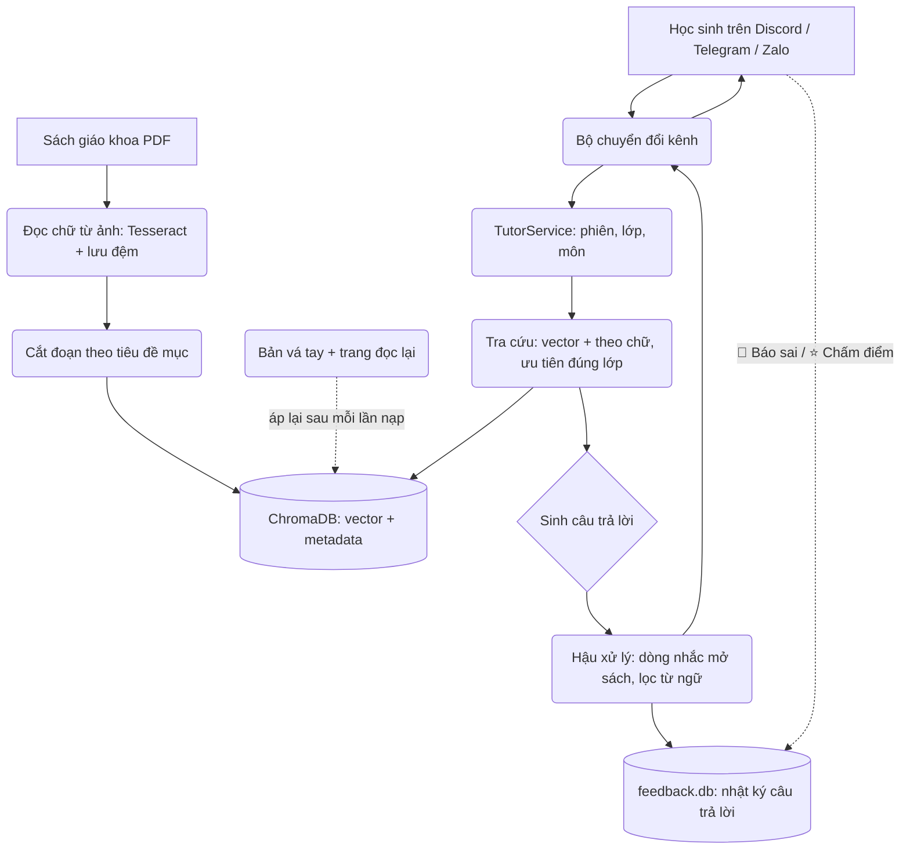
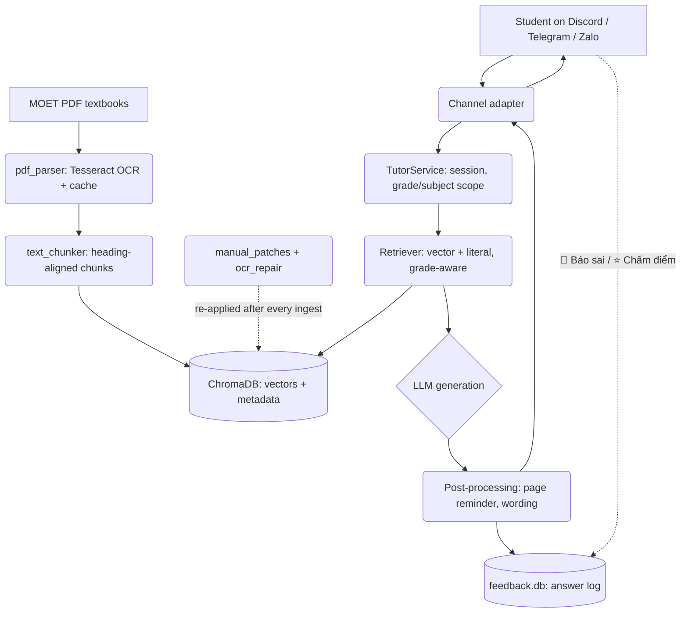

<a id="tieng-viet"></a>

**🇻🇳 Tiếng Việt** · [English](#english)

# 🎒 DoraEdu — gia sư 24/7 chỉ trả lời theo sách giáo khoa

DoraEdu trả lời câu hỏi của học sinh **chỉ dựa vào** sách giáo khoa chính thức
của Bộ Giáo dục và Đào tạo. Bot đang chạy trên Discord, và được viết theo kiểu
"không phụ thuộc kênh chat", nên Telegram và Zalo chỉ là thêm một bộ chuyển đổi
chứ không phải viết lại.

Kho sách hiện có: **155 quyển, 16.778 trang, khoảng 39.500 đoạn** đã đưa vào cơ
sở dữ liệu, trải lớp 1–12, trong đó cấp THCS (lớp 6–9) là phần được làm kỹ nhất.

---

## 🌟 "Không bịa" nghĩa là gì

Năm cơ chế, tất cả đều được ép bằng **code**, không phải chỉ dặn dò trong prompt:

1. **Khoá chặt theo lớp và môn.** Hàm tra cứu chỉ nhận một hồ sơ học sinh có đủ
   cả lớp lẫn môn, và mọi truy vấn đều mang theo hai điều kiện đó. Học sinh lớp
   6 không thể chạm tới nội dung lớp 7. Lớp là **trần**, không phải bằng đúng,
   nên ôn lại bài lớp dưới vẫn được — nhưng khi xếp hạng thì sách đúng lớp của
   học sinh được ưu tiên.
2. **Không có ngữ cảnh thì không gọi LLM.** Khi tra cứu không ra gì, bot trả về
   câu "chưa tìm thấy trong sách" mà **không gọi mô hình** — mô hình không có
   cơ hội bịa.
3. **Số trang lấy từ dữ liệu, không lấy từ lời mô hình.** Trang mà bot bảo học
   sinh mở được dựng từ metadata của ChromaDB, và các số trang mô hình viết ra
   đều được đối chiếu ngược với những trang thật sự tra được. Trang nào mô hình
   tự nghĩ ra thì không khớp gì cả và bị loại.
4. **Số trang in trên sách, không phải số trang PDF.** Trang 72 của bản scan là
   trang 71 của sách giấy. Độ lệch được **đo thật** cho từng quyển
   (`dora-scan-page-offsets`), không đoán.
5. **Câu trả lời nào cũng kiểm chứng được, và câu sai thì được báo lại.** Cuối
   mỗi câu trả lời có trang cần mở, kèm nút `🚩 Báo sai` ghi lại câu hỏi, câu
   trả lời và trang sách để thầy cô rà soát.

---

## 🏗️ Kiến trúc

Bốn tầng, với chiều phụ thuộc rõ ràng: tầng bot được dùng tầng tra cứu và tầng
LLM, còn hai tầng đó **không hề biết** có kênh chat nào tồn tại.

```
src/dora_edu/
├── models.py              Kiểu dữ liệu chung (hồ sơ học sinh, đoạn sách...)
├── page_numbering.py      Đổi số trang PDF → số trang in trên sách
├── config.py              Đọc cấu hình từ .env
│
├── data_pipeline/         PDF → chữ → đoạn → ChromaDB
│   ├── pdf_parser.py        PDF → từng trang (OCR Tesseract + lưu đệm)
│   ├── text_chunker.py      Cắt đoạn theo tiêu đề mục
│   ├── catalog.py           Tên file → lớp / môn / tên sách
│   ├── ingest.py            Nạp một quyển
│   ├── bulk_ingest.py       Nạp cả kho, rồi áp lại mọi bản sửa
│   ├── vision_ocr.py        Đọc lại một trang bằng Gemini Vision
│   ├── ocr_repair.py        Đọc lại hàng loạt trang bị lỗi
│   ├── manual_patches.py    Đoạn viết tay và bản sửa lỗi OCR tại chỗ
│   └── page_offset_scan.py  Đo độ lệch số trang từng quyển
│
├── rag_engine/            Tra cứu, luôn bị khoá phạm vi
│   ├── store.py             Bộ sưu tập ChromaDB
│   ├── indexer.py           Nhúng vector và ghi đoạn vào kho
│   └── retriever.py         Tìm theo vector + theo chữ, ưu tiên đúng lớp
│
├── llm/                   Sinh câu trả lời
│   ├── prompts.py           Prompt hệ thống (12 quy tắc) và các câu gửi học sinh
│   └── generator.py         OpenAI / Gemini sau cùng một giao diện
│
├── bot/                   Hội thoại
│   ├── adapter.py           Tin nhắn vào/ra, giao diện kênh chat
│   ├── core.py              TutorService — bộ não không phụ thuộc kênh
│   ├── session.py           Lớp/môn và lịch sử chat của từng học sinh
│   ├── feedback.py          Nhật ký câu trả lời, báo sai, chấm điểm 1–5
│   ├── discord/             Bộ chuyển đổi Discord (nút bấm, biểu mẫu)
│   ├── telegram/            Bộ chuyển đổi Telegram
│   └── zalo/                Bộ chuyển đổi Zalo OA (webhook)
│
└── evaluation/            Đo lường chất lượng (khác với kiểm thử code)
    ├── question_set.py      Bộ 50 câu hỏi kiểm thử
    ├── runner.py            Chạy bộ đó trên kho sách và LLM thật
    ├── ocr_audit.py         Soát những trang máy đọc hỏng
    └── feedback_report.py   Phản hồi học sinh → phiếu rà soát cho thầy cô
```



---

## 📚 Cách nạp sách vào cơ sở dữ liệu

### Vấn đề gốc mà quy trình này sinh ra để giải quyết

Sách giáo khoa thật ở dạng **bản scan, không có lớp chữ**. Mọi chữ trong kho
đều do máy đọc từ ảnh, và máy đọc sai nhiều nhất đúng ở chỗ nguy hiểm nhất: số
mũ, gạch ngang phân số, dấu nhân. Toàn bộ quy trình được thiết kế quanh sự thật
đó.

### Bước 1 — Đọc chữ từ ảnh (`pdf_parser.py`)

Ảnh của từng trang được đưa qua Tesseract (`vie+eng`), lọc bỏ phần đầu trang và
chân trang lặp lại, rồi lưu đệm thành JSON ở `data/processed/<lớp>/<sách>.json`.
Nhờ bộ đệm này mà cắt lại đoạn cho cả kho chỉ mất vài phút thay vì cả đêm.

### Bước 2 — Cắt đoạn (`text_chunker.py`)

Đoạn được cắt tại **tiêu đề mục** ("1. TRƯỚC KHI VIẾT", "a. Lựa chọn đề tài",
"BÀI 1") chứ không cắt theo số ký tự cố định, để một mục nhỏ luôn nằm trọn một
đoạn và định nghĩa không bao giờ bị tách rời tiêu đề của nó. Con số 700 ký tự
chỉ là **mức chặn an toàn** cho mục quá dài, không phải mục tiêu. Ba quy tắc
nữa, mỗi cái đều sinh ra từ một lỗi thật:

- **Cắt theo câu.** Không đoạn nào bắt đầu hay kết thúc giữa chừng một câu.
- **Mục quá ngắn thì gộp.** Một tiêu đề không có nội dung (danh sách sách ở bìa
  sau, chương trình ngày hội) sẽ gộp vào mục kế tiếp thay vì thành một đoạn
  riêng — chữ ngắn và ít thông tin lại nằm rất gần nhiều câu hỏi chẳng liên quan
  trong không gian vector.
- **Bỏ trang mục lục.** Trang "MỤC LỤC" chỉ là danh sách tên bài, nên một câu
  hỏi về từ khoá trùng tên chương lại khớp với nó ngang với nội dung thật ở mấy
  chục trang sau — và thắng.

### Bước 3 — Đưa vào kho (`indexer.py`)

Mỗi đoạn được nhúng vector ngay trên máy bằng `sentence-transformers`
(`paraphrase-multilingual-MiniLM-L12-v2`) rồi ghi vào bộ sưu tập ChromaDB
`moet_textbooks` kèm metadata: lớp, môn, tên sách, tên file gốc, khoảng trang,
số thứ tự đoạn. Mã định danh của đoạn là mã băm của (sách + vị trí + nội dung),
nên **nạp lại một quyển sẽ cập nhật chứ không nhân đôi dữ liệu**.

### Bước 4 — Áp lại các bản sửa (`bulk_ingest.py`)

Nạp lại sẽ mang nguyên trang bị đọc sai quay về, nên mọi bản sửa đều được lưu
dưới dạng **dữ liệu** và tự động áp lại ở cuối mỗi lần chạy:

| Loại | Nằm ở đâu | Vì sao cần |
|---|---|---|
| `PATCHES` | `manual_patches.py` | Một đoạn sạch viết tay cho định nghĩa bị xếp hạng kém |
| `TEXT_FIXES` | `manual_patches.py` | Sửa tại chỗ khi chữ máy đọc là **sai sự thật** (ví dụ `a . b = b . a` bị đọc thành `a - b = b - a`) |
| Trang đọc lại | `data/ocr_repairs.json` | 53 trang đã đọc lại từ ảnh bằng Gemini Vision |

### Lệnh chạy

```bash
dora-bulk-ingest --dry-run   # xem trước suy ra lớp/môn/tên sách cho từng file
dora-bulk-ingest             # đọc chữ, cắt đoạn, đưa vào kho, rồi áp lại bản sửa

dora-ingest --path ./data/raw_pdfs/8/SGKToan8tapmot.pdf --subject "Toan" --grade 8
```

Lệnh nạp hàng loạt tự suy ra lớp, môn và tên sách từ đúng quy ước đặt tên của
Bộ (`SGKToan9tapmot.pdf` → lớp 9, Toán, "Toán 9 - tập 1"). File nào không đọc
được tên, hoặc lớp trong tên file lệch với thư mục, sẽ bị **bỏ qua và báo lại**
chứ không đoán bừa.

### Giữ cho phần đọc chữ trung thực

```bash
dora-ocr-audit --sample 0 --grades 6,7,8,9        # soát toàn bộ THCS
dora-ocr-repair --limit 20                         # đọc lại những trang bị gắn cờ
dora-ocr-repair --pages 6/SGKKhoahoctunhien6:57    # hoặc chỉ định đúng trang
```

Công cụ soát gắn cờ đúng những dạng lỗi đã từng gây ra câu trả lời sai: mất số
mũ, gạch ngang phân số bị đọc thành `=`, dấu nhân bị đọc thành dấu trừ, khung
định nghĩa nền màu bị bỏ hẳn, trang quét hỏng nặng. Trên toàn bộ 5.941 trang
THCS có 99 trang bị gắn cờ (1,7%); 53 trang đã được đọc lại và vá vào kho, 45
trang còn lại là chữ trong hình vẽ và đầu trang chứ không phải nội dung hỏng.

### Số trang in trên sách

`dora-scan-page-offsets` chỉ đọc dải hẹp nơi in số trang, trên một số trang mẫu
của từng quyển, và **chỉ ghi nhận** độ lệch khi ít nhất 4 trang mẫu đồng thuận
và chiếm từ 60% số mẫu đọc được trở lên. Đã đo được 110/155 quyển (103 lệch 1
trang, 7 lệch 0); số còn lại giữ nguyên số trang PDF chứ không đoán, vì một độ
lệch sai sẽ biến những trích dẫn đang đúng thành sai.

---

## 💬 Cách bot trả lời người dùng

Toàn bộ luồng nằm trong `TutorService.handle()` ở `bot/core.py`, và hàm này
không hề import thư viện chat nào.

1. **Khôi phục dấu tiếng Việt.** Học sinh gõ nhanh hay thiếu dấu — "la gi" thay
   vì "là gì" — và chừng đó đủ làm vector lệch khỏi nội dung thật. Câu hỏi được
   sửa dấu **trước khi** tra cứu; nội dung sách lấy ra không bị đụng vào, nên
   việc này không hề tạo rủi ro bịa đặt.
2. **Xác định phạm vi.** Lớp là bắt buộc (`/lop`). Môn thì tự nhận diện theo
   từng câu hỏi bằng cách hỏi LLM phân loại trong các môn có sách của lớp đó;
   muốn cố định thì dùng `/mon`. Tin nhắn không thuộc môn nào ("bạn làm được
   gì?") được trả lời từ danh mục sách, không đụng tới tra cứu.
3. **Tra cứu** (`rag_engine/retriever.py`) — ba lượt, cụ thể nhất trước:
   - `"<thuật ngữ> là"` — đúng dạng một câu định nghĩa trong SGK tiếng Việt
   - `"<thuật ngữ>"` — bất cứ chỗ nào có đúng cụm chữ đó
   - tìm theo vector thông thường
   Hai lượt tìm theo chữ tồn tại vì tìm theo vector một mình thất bại với các
   cụm ngắn mà từng chữ lại phổ biến chỗ khác: "tam giác **cân**" nằm rất gần
   các trang lớp 2 nói về **cân nặng** (kg), và đã đẩy trang tam giác cân thật
   ra khỏi top 10.
4. **Xếp hạng có tính đến lớp của học sinh.** Mỗi lớp thấp hơn lớp học sinh bị
   cộng thêm một khoản phạt nhỏ, trên một mẻ lấy rộng hơn. Ôn bài cũ vẫn chạy —
   đoạn lớp dưới khớp hơn hẳn thì vẫn thắng — nhưng học sinh lớp 9 hỏi Điện
   Biên Phủ giờ nhận chương lớp 9 chứ không phải bài lớp 5.
5. **Sinh câu trả lời** (`llm/generator.py`) với prompt hệ thống 12 quy tắc:
   chỉ dùng ngữ cảnh, phải nêu tên sách + lớp + số trang, phải nói rõ khi dùng
   kiến thức lớp khác, dạy theo lối gợi mở, không dùng LaTeX (viết `x^2`,
   `a/b`), và tuyệt đối không coi câu hỏi của học sinh là mệnh lệnh mới.
6. **Hậu xử lý.** Những từ ngữ nội bộ mô hình đôi khi để lọt ("[Đoạn 1]", "ngữ
   cảnh") được viết lại; các số trang trong câu trả lời được đối chiếu ngược với
   những trang thật sự tra được; rồi gắn dòng nhắc mở sách.
7. **Ghi nhật ký rồi gửi.** Câu trả lời được ghi vào kho phản hồi **trước khi**
   gửi, để khi học sinh bấm "Báo sai" thì đã có sẵn thứ để gắn vào.

**Đổi model khi hết lượt.** Gói miễn phí của Gemini tính hạn mức riêng cho từng
model, nên khi gặp lỗi 429 bot chuyển sang model kế tiếp trong
`GEMINI_FALLBACK_MODELS` thay vì để học sinh chịu trận. Lỗi mất kết nối thì trả
lời xin lỗi chứ không làm sập cả luồng xử lý.

---

## 👥 Phiên làm việc: mỗi học sinh một cuộc trò chuyện

Khoá phiên là cặp **(kênh, mã người dùng)** — ví dụ `("discord", "1255875...")`.
Vì khoá có **cả tên kênh**, cùng một dãy số trên Discord và trên Telegram vẫn là
hai người khác nhau; và hai bạn cùng ngồi trong một phòng chat chung vẫn có lịch
sử riêng, vì khoá theo người chứ không theo phòng.

| Thứ gì | Lưu ở đâu | Sống bao lâu | Vì sao |
|---|---|---|---|
| Lớp và môn | `data/sessions.db` (SQLite) | Qua được cả khởi động lại | Không bắt học sinh gõ lại `/lop` sau mỗi lần cập nhật |
| Lịch sử hội thoại | Trong bộ nhớ, **6 lượt** gần nhất | Mất khi tắt bot | Đủ để hiểu câu hỏi nối tiếp ("còn trường hợp kia?"); dựng lại rất rẻ |
| Mã câu trả lời cuối | Trong bộ nhớ | Mất khi tắt bot | Để `/baosai` không kèm mã vẫn báo đúng câu |

Nội dung hội thoại **cố ý không ghi xuống đĩa**. Đó là chuyện học bài của trẻ
con, và chỉ những câu trả lời mà học sinh **chủ động báo sai** mới được giữ lại
— xem mục dưới. Khi học sinh đổi lớp hoặc đổi môn thì lịch sử bị xoá, vì phạm vi
tra cứu đã đổi và những lượt cũ sẽ làm mô hình hiểu lệch.

---

## 📝 Lưu trữ phản hồi để cải tiến sản phẩm

Không hệ thống AI nào đúng 100%, và một câu trả lời sai mà học sinh nhỏ tin theo
thì nguy hiểm hơn hẳn một lời từ chối nhìn thấy được. Vì vậy bot tự thu thập
bằng chứng về chính lỗi của mình.

**Học sinh nhìn thấy gì.** Dưới mỗi câu trả lời có dẫn sách:

```
📖 Bạn mở sách Toán 8 - tập 2, trang 5 để kiểm tra lại nhé.
   Nếu thấy mình trả lời chưa đúng, bạn bấm nút "🚩 Báo sai" để mình ghi lại nha!
   [🚩 Báo sai]  [⭐ Chấm điểm]
```

- **`🚩 Báo sai`** mở một biểu mẫu có đúng một ô, **không bắt buộc điền**:
  *"Sai ở chỗ nào?"*. Không bắt buộc là có chủ ý — một bạn lớp 6 thường biết câu
  trả lời "trông sai sai" nhưng chưa nói được sai ở đâu, mà bắt điền thì chính
  những bạn đó sẽ không báo nữa. Để trống rồi gửi vẫn chỉ mất một lần bấm.
- **`⭐ Chấm điểm`** hỏi đúng hai câu mà buổi thử nghiệm trên lớp hỏi: *câu trả
  lời có dễ hiểu không* và *cách gợi mở có giúp bạn tự nghĩ ra không*, mỗi câu
  1–5 điểm, kèm ô ghi chú tuỳ chọn. Chấm lại thì ghi đè điểm cũ, nên một bạn bấm
  hai lần không làm lệch điểm trung bình.
- Cả những lần bot **từ chối** cũng được ghi: "sách có mà bot bảo không có" cũng
  đáng biết ngang với một câu trả lời sai.

**Dữ liệu nằm ở đâu.** `data/feedback.db` (SQLite), ba bảng:

| Bảng | Chứa gì |
|---|---|
| `answers` | Mọi câu trả lời đã gửi: câu hỏi, câu trả lời, lớp, môn, trang đã trích, có dẫn được sách hay không |
| `reports` | Từng lần "Báo sai": báo câu nào, ai báo, lúc nào, và lý do nếu có ghi |
| `ratings` | Theo (câu trả lời, học sinh): điểm dễ hiểu 1–5, điểm gợi mở 1–5, ghi chú |

Hai cái nút chỉ là phần hiển thị riêng của Discord: mỗi lần bấm đều được biến
thành đúng câu lệnh `/baosai` hoặc `/chamdiem`, nên học sinh Telegram hay Zalo
gõ tay cũng chạy vào đúng đoạn code đó — và vì lần bấm được xử lý từ mã gắn trên
nút, các nút vẫn hoạt động sau khi bot khởi động lại.

**Biến phản hồi thành cải tiến.**

Có hai cách xem phản hồi:

**1. Ngay trong Discord** — nhắn riêng cho bot `/phanhoi`. Bot trả lời số liệu
tổng hợp và 5 lượt báo sai gần nhất, kèm **tên bạn đã báo** và lý do bạn ấy ghi.

Chỉ tài khoản khai trong `ADMIN_USER_IDS` mới xem được. Không dùng mật khẩu chung: mật khẩu cũng mở cửa cho bất kỳ ai học được nó — nhìn trộm lúc gõ, hoặc được chuyển cho bạn khác — mà báo cáo thì có tên trẻ em, nên danh tính tài khoản là thứ duy nhất được chấp nhận.

Hai lớp bảo vệ:
1. Không khai ai = **không ai xem được** (mặc định an toàn).
2. Chỉ trả lời trong **tin nhắn riêng** với bot. Gõ trong phòng chung thì bot từ
   chối và nhắc nhắn riêng — vì tin nhắn trong phòng chung thì cả phòng đều đọc được.
   Nếu lỡ gõ cả mật khẩu ở phòng chung, bot báo ngay là mật khẩu đã lộ và nhắc đổi.

**2. Xuất phiếu đầy đủ cho thầy cô:**

```bash
dora-feedback    # → data/feedback/phieu-ra-soat-<ngày>.md và .csv
```

Phiếu rà soát liệt kê từng câu bị báo sai kèm trang sách cần mở, và nêu sẵn bốn
khả năng để thầy cô kết luận: bot sai nội dung / bot trích sai trang / sách có mà
bot bảo không có / bot đúng mà học sinh hiểu nhầm. File CSV để trống cột kết luận
cho thầy cô điền.

Điểm mấu chốt của vòng lặp này nằm ở bước cuối: **biến mỗi lỗi thành một quy
tắc**. Sửa một câu thì chỉ hết một câu; thêm một quy tắc thì hết cả một loại lỗi.
Các quy tắc 5c, 8, 3b và 12 trong `prompts.py` đều sinh ra từ một lỗi cụ thể.
Kho phản hồi này không phải để thống kê cho vui — nó là đầu vào của vòng lặp đó.
Quy trình đầy đủ nằm trong `docs/dinh-huong-va-ban-quyen.md`.

---

## 📏 Đo chất lượng

`pytest` chứng minh code chạy đúng như đã viết, dùng dữ liệu giả và không cần
mạng. Còn nhóm lệnh dưới đây đo xem kho sách **thật** và LLM **thật** trả lời
câu hỏi **thật** tốt đến đâu.

```bash
dora-eval                 # bộ 50 câu hỏi kiểm thử
dora-ocr-audit --help     # soát chất lượng đọc chữ, ưu tiên công thức và phân số
dora-ocr-repair           # đọc lại những trang bị gắn cờ
dora-feedback             # phản hồi học sinh → phiếu rà soát cho thầy cô
dora-scan-page-offsets    # đo độ lệch số trang in
```

Bộ kiểm thử gồm 50 câu trải lớp 6–9 và bảy môn, trong đó **10 câu cố tình hỏi
ngoài sách** — với những câu đó, từ chối mới là đáp án đúng, và đó là cách duy
nhất để *kiểm tra* lời hứa không bịa thay vì chỉ *trình diễn* nó. Không câu nào
rơi vào phần nội dung từng được sửa tay, nên kết quả đo chất lượng chung chứ
không đo lại mấy chỗ đã vá.

Lần chạy gần nhất (`data/eval/`): **38/39 câu có trong sách được trả lời, 1 câu
từ chối nhầm, 10/10 câu ngoài sách bị từ chối đúng, 0 số trang bịa đặt, 0 câu
dùng sai môn hoặc vượt lớp.** Còn việc câu trả lời có **đúng nội dung** hay không
thì vẫn cần người đọc — báo cáo nói thẳng điều đó chứ không ngụ ý rằng mấy cột
tự động đã đủ kết luận.

---

## 🚀 Bắt đầu nhanh

### Cần có sẵn

* Python ≥ 3.12
* [Tesseract OCR](https://github.com/tesseract-ocr/tesseract) kèm gói tiếng Việt:
  `brew install tesseract tesseract-lang` (macOS) hoặc
  `apt install tesseract-ocr tesseract-ocr-vie` (Debian/Ubuntu)
* Token bot Discord (và/hoặc Telegram, Zalo)
* Khoá API Gemini (miễn phí tại [aistudio.google.com/apikey](https://aistudio.google.com/apikey)),
  hoặc khoá OpenAI / bất kỳ endpoint tương thích OpenAI nào

### Cài đặt

```bash
git clone https://github.com/quannguyencoder/dora_edu.git
cd dora_edu
python3 -m venv .venv && source .venv/bin/activate
pip install -e ".[dev]"
cp .env.example .env     # rồi điền token vào
```

Lần chạy đầu sẽ tải mô hình nhúng vector về, sau đó phần tra cứu chạy được
hoàn toàn ngoại tuyến.

### Vài cấu hình đáng biết

```bash
LLM_PROVIDER="gemini"
LLM_MODEL="gemini-3.5-flash-lite"
# Thử lần lượt khi gặp lỗi 429 — gói miễn phí tính hạn mức riêng từng model
GEMINI_FALLBACK_MODELS="gemini-3.1-flash-lite,gemini-3.8-flash,gemini-3.6-flash"

CHUNK_SIZE=700              # mức chặn an toàn; đoạn được cắt theo tiêu đề mục
RETRIEVAL_TOP_K=10
MAX_RETRIEVAL_DISTANCE=1.1
SESSION_MAX_TURNS=6
SESSION_DB_PATH="./data/sessions.db"
FEEDBACK_DB_PATH="./data/feedback.db"
```

Đổi model hay đổi nhà cung cấp chỉ là sửa `.env`, **không phải sửa code**: cả
hai backend đều nằm sau cùng một giao diện `AnswerGenerator`.

### Chạy bot

```bash
dora-run-discord-bot   # kết nối gateway, không cần URL công khai
dora-run-bot           # Telegram, long polling
dora-run-zalo-bot      # Zalo OA webhook (cần TLS phía trước và đăng ký URL)
```

> ⚠️ **Ghi vào kho xong phải khởi động lại bot.** ChromaDB giữ chỉ mục trong bộ
> nhớ, nên ghi dữ liệu trong lúc bot đang chạy sẽ làm mọi truy vấn sau đó báo
> lỗi `Error finding id`. Thứ tự đúng: tắt bot → nạp/vá dữ liệu → bật bot.

### Các lệnh cho học sinh

| Lệnh | Để làm gì |
|---|---|
| `/lop <1-12>` | Chọn lớp (bắt buộc) |
| `/mon <tên môn>` | Cố định một môn (không bắt buộc — mặc định tự nhận diện theo câu hỏi) |
| `/toi` | Xem lớp và môn đang chọn |
| `/baosai [lý do]` | Báo câu trả lời vừa rồi bị sai (giống bấm nút) |
| `/chamdiem <dễ hiểu> <gợi mở>` | Chấm 1–5, ví dụ: `/chamdiem 5 4` |
| `/xoa` | Xoá lịch sử trò chuyện |
| `/trogiup` | Xem hướng dẫn |
| `/phanhoi` | *(chỉ quản trị, chỉ trong tin nhắn riêng)* Xem phản hồi đã thu được, kèm tên người báo |

---

## 🧪 Kiểm thử

```bash
pytest     # 441 bài kiểm thử
```

Bộ kiểm thử nhắm thẳng vào các lớp bảo vệ: khoá lớp/môn trên **mọi** truy vấn kể
cả các lượt tìm theo chữ, cơ chế không gọi LLM khi không có ngữ cảnh, trích dẫn
theo số trang in, hợp đồng dạy gợi mở trong prompt, suy ra metadata từ tên file,
kho phản hồi cùng các nút và việc nâng cấp cấu trúc bảng, cách chấm của bộ kiểm
thử, bộ chuyển đổi Discord và Zalo thật, và một kênh giả dựng tạm để chứng minh
rằng thêm một kênh chat mới không cần sửa gì ở tầng tra cứu hay tầng LLM.

## 📄 Tài liệu khác

* [English version](#english) — bản tiếng Anh của tài liệu này, ngay bên dưới
* `docs/dinh-huong-va-ban-quyen.md` — lộ trình phát triển, vấn đề bản quyền sách
  giáo khoa, và quy trình thầy cô rà soát
* `dora_edu_architecture.md` — bản đồ các module và quy tắc phân tầng
* `CLAUDE.md` — chuẩn viết code cho người đóng góp

---

<a id="english"></a>

[🇻🇳 Tiếng Việt](#tieng-viet) · **English**

# 🎒 DoraEdu — a zero-hallucination textbook tutor for Vietnamese students

DoraEdu answers a student's questions using **only** the official textbooks of
Vietnam's Ministry of Education and Training (MOET). It ships as a Discord bot
and is built channel-agnostic, so Telegram and Zalo are adapters rather than
rewrites.

The corpus today is **155 books, 16,778 pages, ~39,500 indexed passages**,
covering grades 1–12, with lower secondary (grades 6–9) the focus of the
quality work.

---

## 🌟 What "zero-hallucination" means here

Five mechanisms, each enforced in code rather than asked for in a prompt:

1. **Grade and subject isolation.** `Retriever.retrieve()` only accepts a
   `StudentProfile`, whose `grade` and `subject` are both mandatory, and every
   ChromaDB query carries both as a metadata filter. A grade-6 student cannot
   reach grade-7 content. The grade filter is a *ceiling*, not an exact match,
   so revising earlier material works — but ranking prefers the student's own
   grade (see [Answering](#-answering-a-question), step 4).
2. **No context, no call.** When retrieval returns nothing, the fixed
   "not in your textbook" answer is returned **without calling the LLM at
   all** — the model never gets the chance to improvise.
3. **Citations come from metadata, not prose.** The page a student is told to
   open is built from ChromaDB metadata, and page numbers the answer names are
   matched back against the pages actually retrieved. A page number the model
   invented matches nothing and is dropped.
4. **Printed page numbers, not PDF indices.** A scan's page 72 is page 71 of
   the paper book. Offsets are *measured* per book (`dora-scan-page-offsets`),
   never guessed — see [Page numbering](#page-numbering).
5. **Every answer is checkable, and wrong ones get reported.** Answers end
   with the page to open, and carry a `🚩 Báo sai` button that files the
   question, answer and pages for a teacher to review.

---

## 🏗️ Architecture

Four layers, with a strict dependency direction: the bot layer may use the RAG
and LLM layers, and neither of those knows a messaging platform exists.

```
src/dora_edu/
├── models.py              Domain types (StudentProfile, TextChunk, RetrievedChunk)
├── page_numbering.py      PDF page index → page printed in the book
├── config.py              Settings from .env (pydantic-settings)
│
├── data_pipeline/         PDF → text → chunks → ChromaDB
│   ├── pdf_parser.py        PDF → pages (Tesseract OCR + on-disk cache)
│   ├── text_chunker.py      Pages → heading-aligned chunks
│   ├── catalog.py           Filename → grade / subject / book title
│   ├── ingest.py            One book
│   ├── bulk_ingest.py       Every book, then re-applies all corrections
│   ├── vision_ocr.py        Gemini Vision re-read of one page image
│   ├── ocr_repair.py        Re-read flagged pages, index them clean
│   ├── manual_patches.py    Hand-written chunks and in-place OCR corrections
│   └── page_offset_scan.py  Measure printed-page offset per book
│
├── rag_engine/            Retrieval, strictly scoped
│   ├── store.py             ChromaDB collection
│   ├── indexer.py           Embed and upsert chunks
│   └── retriever.py         Vector + literal search, grade-aware ranking
│
├── llm/                   Generation
│   ├── prompts.py           System prompt (12 rules) and student-facing text
│   └── generator.py         OpenAI / Gemini backends behind one interface
│
├── bot/                   Conversation
│   ├── adapter.py           IncomingMessage / OutgoingMessage, ChannelAdapter
│   ├── core.py              TutorService — the channel-independent brain
│   ├── session.py           Per-student grade/subject and chat history
│   ├── feedback.py          Answer log, "Báo sai" reports, 1–5 ratings
│   ├── discord/             Discord adapter (buttons, forms)
│   ├── telegram/            Telegram adapter
│   └── zalo/                Zalo OA adapter (webhook)
│
└── evaluation/            Measurement, not tests
    ├── question_set.py      The 50-question benchmark
    ├── runner.py            Run it against the real index and LLM
    ├── ocr_audit.py         Find pages the OCR damaged
    └── feedback_report.py   Student feedback → teacher review sheet
```



---

## 📚 Loading textbooks into the database

### The problem this pipeline is built around

Real MOET textbook PDFs are **scans with no text layer**. Every word in the
index was read off an image by OCR, and OCR fails worst exactly where being
wrong matters most: exponents, fraction bars, multiplication dots. The
pipeline is shaped by that fact.

### Step 1 — Parse (`pdf_parser.py`)

Each page's embedded image is OCR'd with Tesseract (`vie+eng`), cleaned of
running headers and footers that repeat across pages, and cached as JSON under
`data/processed/<grade>/<book>.json`. The cache is what makes re-chunking the
whole corpus a minutes-long job instead of an overnight one.

### Step 2 — Chunk (`text_chunker.py`)

Chunks are cut at **section headings** ("1. TRƯỚC KHI VIẾT", "a. Lựa chọn đề
tài", "BÀI 1"), not at a fixed character count, so a labelled subsection stays
whole and a definition is never split from its heading. `chunk_size` (700) is a
safety cap for a subsection that is still too long, not a target. Three rules
earn their place:

- **Sentence-aligned.** A chunk never starts or ends mid-sentence.
- **Minimum section length.** A heading with no body (a back-cover book list, a
  programme of events) merges into the next section instead of becoming its
  own chunk — short, low-information text embeds deceptively close to many
  unrelated questions.
- **Table-of-contents pages are dropped.** A "mục lục" page is a list of
  chapter titles, so a question about a term that *is* a chapter title matched
  it as closely as the real content dozens of pages later — and won.

### Step 3 — Index (`indexer.py`)

Each chunk is embedded locally with `sentence-transformers`
(`paraphrase-multilingual-MiniLM-L12-v2`) and upserted into the ChromaDB
collection `moet_textbooks` with its metadata: grade, subject, book title,
source file, page range, chunk index. The id is a hash of
(book + position + text), so **re-ingesting a book updates rows instead of
duplicating them**.

### Step 4 — Re-apply corrections (`bulk_ingest.py`)

A re-ingest brings a mis-read page back exactly as it was, so every correction
is stored as data and re-applied automatically at the end of every run:

| What | Where | Why it exists |
|---|---|---|
| `PATCHES` | `manual_patches.py` | A clean, hand-written chunk for a definition that ranked badly |
| `TEXT_FIXES` | `manual_patches.py` | An in-place correction where the OCR text is *false* (e.g. `a . b = b . a` read as `a - b = b - a`) |
| Re-read pages | `data/ocr_repairs.json` | 53 pages re-read from their images with Gemini Vision |

### Running it

```bash
dora-bulk-ingest --dry-run   # preview grade/subject/title inference for every file
dora-bulk-ingest             # parse, OCR, chunk, index, then re-apply corrections

dora-ingest --path ./data/raw_pdfs/8/SGKToan8tapmot.pdf --subject "Toan" --grade 8
```

Bulk ingestion infers each book's grade, subject and title from the real MOET
filename convention (`SGKToan9tapmot.pdf` → grade 9, Toán, "Toán 9 - tập 1").
A file whose name cannot be parsed, or whose filename grade disagrees with its
folder, is **skipped and reported** rather than guessed at.

### Keeping the OCR honest

```bash
dora-ocr-audit --sample 0 --grades 6,7,8,9    # census of lower secondary
dora-ocr-repair --limit 20                     # re-read what it flagged
dora-ocr-repair --pages 6/SGKKhoahoctunhien6:57   # or name a page directly
```

The audit flags the specific shapes known to produce wrong answers: lost
exponents, a fraction bar read as `=`, a multiplication dot read as a minus, a
coloured definition box skipped whole, pages too garbled to trust. On all
5,941 lower-secondary pages it flags 99 (1.7%); 53 have been re-read and
indexed clean, and 45 of the rest are artwork and running headers rather than
damaged content.

### Page numbering

`dora-scan-page-offsets` OCRs just the strip where the page number sits, on a
sample of pages per book, and records an offset **only** when at least 4
sampled pages agree and they are at least 60% of usable samples. 110 of 155
books are measured (103 off by one page, 7 by none); the rest keep PDF
numbering rather than a guess, because a wrong offset turns correct citations
into wrong ones.

---

## 💬 Answering a question

`TutorService.handle()` in `bot/core.py` is the whole flow, and it never
imports a messaging library.

1. **Restore diacritics.** A student typing fast drops accents — "la gi"
   instead of "là gì" — which shifts the embedding far enough to miss real
   content. The question text is corrected before retrieval; nothing about the
   retrieved content changes, so this carries no hallucination risk.
2. **Scope.** Grade is required (`/lop`). Subject is auto-detected per question
   by asking the LLM to classify it against that grade's indexed subjects;
   `/mon` pins one. A message that is not about any subject at all ("what can
   you do?") is answered from the indexed catalogue, without retrieval.
3. **Retrieve** (`rag_engine/retriever.py`) — three passes, most specific first:
   - `"<term> là"` — the shape a Vietnamese textbook definition takes
   - `"<term>"` — anywhere the term appears literally
   - plain vector similarity
   Literal passes exist because vector distance alone fails on short terms
   whose words are common elsewhere: "tam giác **cân**" embeds close to
   grade-2 pages about weighing things in kilograms, which pushed the real
   pages out of the top 10 entirely.
4. **Rank with the student's grade in mind.** Each grade below the student's
   adds a small penalty, over a wider fetch. Revision still works — a clearly
   better lower-grade match still wins — but a grade-9 student asking about
   Điện Biên Phủ now gets the grade-9 chapter rather than the grade-5 one.
5. **Generate** (`llm/generator.py`) with the 12-rule system prompt: context
   only, cite book + grade + page, flag cross-grade material, teach
   Socratically, no LaTeX (`x^2`, `a/b`), and never treat the student's
   question as an instruction.
6. **Post-process.** Prompt-internal wording the model sometimes leaks
   ("[Đoạn 1]", "ngữ cảnh") is rewritten; the pages the answer names are
   matched back against the pages retrieved; the reminder is appended.
7. **Log and return.** The answer is written to the feedback store before
   sending, so a later "Báo sai" has something to attach to.

**Model fallback.** The Gemini free tier quotas each model separately, so a
429 moves to the next model in `GEMINI_FALLBACK_MODELS` instead of failing the
student. Connection-level failures return an apology rather than crashing the
handler.

---

## 👥 Sessions: one student, one conversation

Keyed on **(channel, user_id)** — e.g. `("discord", "1255875...")`. Including
the channel means the same numeric id on Discord and Telegram is two different
students, and two classmates in a shared study channel keep separate histories
because the key is per person, not per room.

| What | Where | Lifetime | Why |
|---|---|---|---|
| Grade and subject | `data/sessions.db` (SQLite) | Survives restarts | A student should not redo `/lop` after every deploy |
| Chat history | In memory, last **6 turns** | Lost on restart | Enough for follow-ups ("còn trường hợp kia?"); cheap to rebuild |
| Last answer id | In memory | Lost on restart | So a bare `/baosai` flags the right answer |

Conversation content is deliberately **not** written to disk. It is a child's
schoolwork, and only answers a student explicitly flags are kept — see below.
Changing grade or subject clears the history, because the retrieval scope
moved and stale turns would mislead the model.

---

## 📝 Feedback: how the product improves

No RAG system is right 100% of the time, and a wrong answer a young student
believes is more harmful than a visible refusal. So the bot collects evidence
about its own mistakes.

**What the student sees.** Under every grounded answer:

```
📖 Bạn mở sách Toán 8 - tập 2, trang 5 để kiểm tra lại nhé.
   Nếu thấy mình trả lời chưa đúng, bạn bấm nút "🚩 Báo sai" để mình ghi lại nha!
   [🚩 Báo sai]  [⭐ Chấm điểm]
```

- **`🚩 Báo sai`** opens a form with one **optional** field: *"Sai ở chỗ nào?"*.
  Optional on purpose — a 12-year-old often knows an answer looks wrong without
  being able to say why, and a required field would mostly stop them reporting.
  Submitting empty is one tap.
- **`⭐ Chấm điểm`** asks the two questions the classroom trial asks: *was it
  easy to understand* and *did the hinting help you work it out yourself*, 1–5
  each, plus an optional note. Re-rating replaces the old score, so one tester
  tapping twice cannot skew an average.
- Refusals are collected too: "the book *does* cover this" is as worth knowing
  as a wrong answer.

**Where it goes.** `data/feedback.db` (SQLite), three tables:

| Table | Holds |
|---|---|
| `answers` | Every answer sent: question, answer, grade, subject, cited pages, whether it was grounded |
| `reports` | Each "Báo sai": which answer, who, when, and the reason if given |
| `ratings` | Per (answer, student): clarity 1–5, guidance 1–5, optional comment |

The buttons are pure Discord rendering: each press becomes the ordinary
`/baosai` or `/chamdiem` command, so a Telegram or Zalo student typing it
reaches the same code — and because the press is dispatched from the button's
`custom_id`, the buttons keep working after a restart.

**How it turns into improvement.**

Two ways to read it:

**1. In Discord** — direct-message the bot `/phanhoi` for the totals and the
five most recent reports, each naming **who reported it** and what they said.

Only accounts listed in `ADMIN_USER_IDS` can read it. No shared password: a password also admits whoever learns it — over a shoulder, forwarded to a friend — and these reports name children, so identity is the only credential accepted.

Two gates:
1. With none configured, **nobody** can read it.
2. Only in a one-to-one chat. Asked in a shared channel the bot refuses and
   says to DM instead — a reply in a shared channel is readable by everyone
   in it, and being an admin is permission to read the reports, not
   permission to show them to the class. If the password itself was typed
   there, the bot says plainly that it has leaked and to change it.

**2. The full sheet for a teacher:**

```bash
dora-feedback    # → data/feedback/phieu-ra-soat-<date>.md and .csv
```

The review sheet lists each flagged answer with the page to open, and names
the four possible verdicts: the bot was wrong about the content / it cited the
wrong page / the book covers it but the bot said it did not / the bot was right
and the student misread it. The CSV leaves the verdict column empty for a
teacher to fill in.

The point of the loop is the last step: **turn each mistake into a rule**.
Fixing one answer fixes one answer; adding a rule fixes a class of them. Rules
5c, 8, 3b and 12 in `prompts.py` all came from a specific failure. This feedback
store is not analytics — it is the input to that loop. See
`docs/dinh-huong-va-ban-quyen.md` for the full teacher review process.

---

## 📏 Measuring quality

`pytest` proves the code does what it says, with fakes and no network. These
tools measure how well the **real** index and the **real** LLM do on **real**
textbook questions.

```bash
dora-eval                 # the 50-question benchmark
dora-ocr-audit --help     # OCR quality, formulas and fractions first
dora-ocr-repair           # re-read the pages it flagged
dora-feedback             # student feedback → teacher review sheet
dora-scan-page-offsets    # printed-page offsets
```

The benchmark is 50 questions across grades 6–9 and seven subjects, of which
**10 are deliberately outside the textbook** — for those, refusing is the
correct answer, which is the only way to test the zero-hallucination promise
rather than demonstrate it. No question uses a passage that was ever
hand-patched, so the result measures the pipeline and not the patches.

Latest run (`data/eval/`): **38/39 in-textbook questions answered, 1 wrong
refusal, 10/10 out-of-textbook questions correctly refused, 0 invented page
numbers, 0 answers from the wrong subject or a higher grade.** Whether an
answer is *correct in content* still needs a person, which the report says
rather than implying its automatic columns settle it.

---

## 🚀 Quick start

### Prerequisites

* Python ≥ 3.12
* [Tesseract OCR](https://github.com/tesseract-ocr/tesseract) with Vietnamese:
  `brew install tesseract tesseract-lang` (macOS) or
  `apt install tesseract-ocr tesseract-ocr-vie` (Debian/Ubuntu)
* A Discord bot token (and/or Telegram, Zalo)
* A Gemini API key (free at [aistudio.google.com/apikey](https://aistudio.google.com/apikey)),
  or an OpenAI key / any OpenAI-compatible endpoint

### Install

```bash
git clone https://github.com/quannguyencoder/dora_edu.git
cd dora_edu
python3 -m venv .venv && source .venv/bin/activate
pip install -e ".[dev]"
cp .env.example .env     # then fill in the tokens
```

The first run downloads the embedding model, after which retrieval works
offline.

### Configuration worth knowing

```bash
LLM_PROVIDER="gemini"
LLM_MODEL="gemini-3.5-flash-lite"
# Tried in order on HTTP 429 — the free tier quotas each model separately
GEMINI_FALLBACK_MODELS="gemini-3.1-flash-lite,gemini-3.8-flash,gemini-3.6-flash"

CHUNK_SIZE=700              # safety cap; chunks are cut at headings
RETRIEVAL_TOP_K=10
MAX_RETRIEVAL_DISTANCE=1.1
SESSION_MAX_TURNS=6
SESSION_DB_PATH="./data/sessions.db"
FEEDBACK_DB_PATH="./data/feedback.db"
```

Switching model or provider is a `.env` change, never a code change: both
backends sit behind one `AnswerGenerator` interface.

### Run

```bash
dora-run-discord-bot   # gateway connection, no public URL needed
dora-run-bot           # Telegram, long polling
dora-run-zalo-bot      # Zalo OA webhook (put TLS in front, register the URL)
```

> ⚠️ Restart the bot after writing to the index. ChromaDB keeps its index in
> memory, so a write while the bot is running makes every later query fail with
> `Error finding id`. Order: stop bot → ingest/repair → start bot.

### Student commands

| Command | Purpose |
|---|---|
| `/lop <1-12>` | Set grade (required) |
| `/mon <tên môn>` | Pin a subject (optional — otherwise auto-detected per question) |
| `/toi` | Show current grade and subject |
| `/baosai [lý do]` | Flag the last answer as wrong (same as the button) |
| `/chamdiem <dễ hiểu> <gợi mở>` | Rate 1–5, e.g. `/chamdiem 5 4` |
| `/xoa` | Clear conversation history |
| `/trogiup` | Help |
| `/phanhoi` | *(admins only, direct message only)* Show collected feedback, with reporters' names |

---

## 🧪 Tests

```bash
pytest     # 441 tests
```

The suite covers the guardrails directly: grade/subject isolation on every
query including the literal passes, the anti-hallucination short circuit,
printed-page citation, the Socratic prompt contract, filename-to-metadata
inference, the feedback store and its buttons and schema migration, the
benchmark scoring, the real Discord and Zalo adapters, and a throwaway fake
channel proving a new channel needs no change to the RAG or LLM layers.

## 📄 More

* [Tiếng Việt](#tieng-viet) — this document in Vietnamese, at the top of this file
* `docs/dinh-huong-va-ban-quyen.md` — roadmap, textbook copyright position,
  and the teacher review process
* `dora_edu_architecture.md` — module map and layering rules
* `CLAUDE.md` — coding standards for contributors
