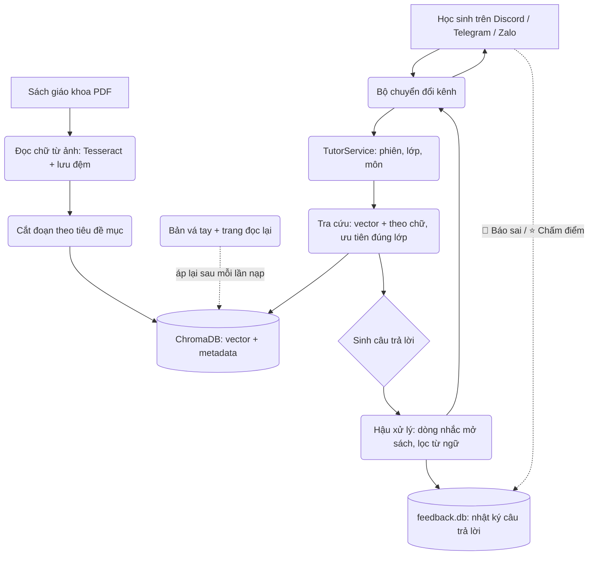

# 🎒 DoraEdu — gia sư 24/7 chỉ trả lời theo sách giáo khoa

DoraEdu trả lời câu hỏi của học sinh **chỉ dựa vào** sách giáo khoa chính thức
của Bộ Giáo dục và Đào tạo. Bot đang chạy trên Discord, và được viết theo kiểu
"không phụ thuộc kênh chat", nên Telegram và Zalo chỉ là thêm một bộ chuyển đổi
chứ không phải viết lại.

Kho sách hiện có: **155 quyển, 16.778 trang, khoảng 39.500 đoạn** đã đưa vào cơ
sở dữ liệu, trải lớp 1–12, trong đó cấp THCS (lớp 6–9) là phần được làm kỹ nhất.

---

## 🌟 "Không bịa" nghĩa là gì

Năm cơ chế, tất cả đều được ép bằng **code**, không phải chỉ dặn dò trong prompt:

1. **Khoá chặt theo lớp và môn.** Hàm tra cứu chỉ nhận một hồ sơ học sinh có đủ
   cả lớp lẫn môn, và mọi truy vấn đều mang theo hai điều kiện đó. Học sinh lớp
   6 không thể chạm tới nội dung lớp 7. Lớp là **trần**, không phải bằng đúng,
   nên ôn lại bài lớp dưới vẫn được — nhưng khi xếp hạng thì sách đúng lớp của
   học sinh được ưu tiên.
2. **Không có ngữ cảnh thì không gọi LLM.** Khi tra cứu không ra gì, bot trả về
   câu "chưa tìm thấy trong sách" mà **không gọi mô hình** — mô hình không có
   cơ hội bịa.
3. **Số trang lấy từ dữ liệu, không lấy từ lời mô hình.** Trang mà bot bảo học
   sinh mở được dựng từ metadata của ChromaDB, và các số trang mô hình viết ra
   đều được đối chiếu ngược với những trang thật sự tra được. Trang nào mô hình
   tự nghĩ ra thì không khớp gì cả và bị loại.
4. **Số trang in trên sách, không phải số trang PDF.** Trang 72 của bản scan là
   trang 71 của sách giấy. Độ lệch được **đo thật** cho từng quyển
   (`dora-scan-page-offsets`), không đoán.
5. **Câu trả lời nào cũng kiểm chứng được, và câu sai thì được báo lại.** Cuối
   mỗi câu trả lời có trang cần mở, kèm nút `🚩 Báo sai` ghi lại câu hỏi, câu
   trả lời và trang sách để thầy cô rà soát.

---

## 🏗️ Kiến trúc

Bốn tầng, với chiều phụ thuộc rõ ràng: tầng bot được dùng tầng tra cứu và tầng
LLM, còn hai tầng đó **không hề biết** có kênh chat nào tồn tại.

```
src/dora_edu/
├── models.py              Kiểu dữ liệu chung (hồ sơ học sinh, đoạn sách...)
├── page_numbering.py      Đổi số trang PDF → số trang in trên sách
├── config.py              Đọc cấu hình từ .env
│
├── data_pipeline/         PDF → chữ → đoạn → ChromaDB
│   ├── pdf_parser.py        PDF → từng trang (OCR Tesseract + lưu đệm)
│   ├── text_chunker.py      Cắt đoạn theo tiêu đề mục
│   ├── catalog.py           Tên file → lớp / môn / tên sách
│   ├── ingest.py            Nạp một quyển
│   ├── bulk_ingest.py       Nạp cả kho, rồi áp lại mọi bản sửa
│   ├── vision_ocr.py        Đọc lại một trang bằng Gemini Vision
│   ├── ocr_repair.py        Đọc lại hàng loạt trang bị lỗi
│   ├── manual_patches.py    Đoạn viết tay và bản sửa lỗi OCR tại chỗ
│   └── page_offset_scan.py  Đo độ lệch số trang từng quyển
│
├── rag_engine/            Tra cứu, luôn bị khoá phạm vi
│   ├── store.py             Bộ sưu tập ChromaDB
│   ├── indexer.py           Nhúng vector và ghi đoạn vào kho
│   └── retriever.py         Tìm theo vector + theo chữ, ưu tiên đúng lớp
│
├── llm/                   Sinh câu trả lời
│   ├── prompts.py           Prompt hệ thống (12 quy tắc) và các câu gửi học sinh
│   └── generator.py         OpenAI / Gemini sau cùng một giao diện
│
├── bot/                   Hội thoại
│   ├── adapter.py           Tin nhắn vào/ra, giao diện kênh chat
│   ├── core.py              TutorService — bộ não không phụ thuộc kênh
│   ├── session.py           Lớp/môn và lịch sử chat của từng học sinh
│   ├── feedback.py          Nhật ký câu trả lời, báo sai, chấm điểm 1–5
│   ├── discord/             Bộ chuyển đổi Discord (nút bấm, biểu mẫu)
│   ├── telegram/            Bộ chuyển đổi Telegram
│   └── zalo/                Bộ chuyển đổi Zalo OA (webhook)
│
└── evaluation/            Đo lường chất lượng (khác với kiểm thử code)
    ├── question_set.py      Bộ 50 câu hỏi kiểm thử
    ├── runner.py            Chạy bộ đó trên kho sách và LLM thật
    ├── ocr_audit.py         Soát những trang máy đọc hỏng
    └── feedback_report.py   Phản hồi học sinh → phiếu rà soát cho thầy cô
```



---

## 📚 Cách nạp sách vào cơ sở dữ liệu

### Vấn đề gốc mà quy trình này sinh ra để giải quyết

Sách giáo khoa thật ở dạng **bản scan, không có lớp chữ**. Mọi chữ trong kho
đều do máy đọc từ ảnh, và máy đọc sai nhiều nhất đúng ở chỗ nguy hiểm nhất: số
mũ, gạch ngang phân số, dấu nhân. Toàn bộ quy trình được thiết kế quanh sự thật
đó.

### Bước 1 — Đọc chữ từ ảnh (`pdf_parser.py`)

Ảnh của từng trang được đưa qua Tesseract (`vie+eng`), lọc bỏ phần đầu trang và
chân trang lặp lại, rồi lưu đệm thành JSON ở `data/processed/<lớp>/<sách>.json`.
Nhờ bộ đệm này mà cắt lại đoạn cho cả kho chỉ mất vài phút thay vì cả đêm.

### Bước 2 — Cắt đoạn (`text_chunker.py`)

Đoạn được cắt tại **tiêu đề mục** ("1. TRƯỚC KHI VIẾT", "a. Lựa chọn đề tài",
"BÀI 1") chứ không cắt theo số ký tự cố định, để một mục nhỏ luôn nằm trọn một
đoạn và định nghĩa không bao giờ bị tách rời tiêu đề của nó. Con số 700 ký tự
chỉ là **mức chặn an toàn** cho mục quá dài, không phải mục tiêu. Ba quy tắc
nữa, mỗi cái đều sinh ra từ một lỗi thật:

- **Cắt theo câu.** Không đoạn nào bắt đầu hay kết thúc giữa chừng một câu.
- **Mục quá ngắn thì gộp.** Một tiêu đề không có nội dung (danh sách sách ở bìa
  sau, chương trình ngày hội) sẽ gộp vào mục kế tiếp thay vì thành một đoạn
  riêng — chữ ngắn và ít thông tin lại nằm rất gần nhiều câu hỏi chẳng liên quan
  trong không gian vector.
- **Bỏ trang mục lục.** Trang "MỤC LỤC" chỉ là danh sách tên bài, nên một câu
  hỏi về từ khoá trùng tên chương lại khớp với nó ngang với nội dung thật ở mấy
  chục trang sau — và thắng.

### Bước 3 — Đưa vào kho (`indexer.py`)

Mỗi đoạn được nhúng vector ngay trên máy bằng `sentence-transformers`
(`paraphrase-multilingual-MiniLM-L12-v2`) rồi ghi vào bộ sưu tập ChromaDB
`moet_textbooks` kèm metadata: lớp, môn, tên sách, tên file gốc, khoảng trang,
số thứ tự đoạn. Mã định danh của đoạn là mã băm của (sách + vị trí + nội dung),
nên **nạp lại một quyển sẽ cập nhật chứ không nhân đôi dữ liệu**.

### Bước 4 — Áp lại các bản sửa (`bulk_ingest.py`)

Nạp lại sẽ mang nguyên trang bị đọc sai quay về, nên mọi bản sửa đều được lưu
dưới dạng **dữ liệu** và tự động áp lại ở cuối mỗi lần chạy:

| Loại | Nằm ở đâu | Vì sao cần |
|---|---|---|
| `PATCHES` | `manual_patches.py` | Một đoạn sạch viết tay cho định nghĩa bị xếp hạng kém |
| `TEXT_FIXES` | `manual_patches.py` | Sửa tại chỗ khi chữ máy đọc là **sai sự thật** (ví dụ `a . b = b . a` bị đọc thành `a - b = b - a`) |
| Trang đọc lại | `data/ocr_repairs.json` | 53 trang đã đọc lại từ ảnh bằng Gemini Vision |

### Lệnh chạy

```bash
dora-bulk-ingest --dry-run   # xem trước suy ra lớp/môn/tên sách cho từng file
dora-bulk-ingest             # đọc chữ, cắt đoạn, đưa vào kho, rồi áp lại bản sửa

dora-ingest --path ./data/raw_pdfs/8/SGKToan8tapmot.pdf --subject "Toan" --grade 8
```

Lệnh nạp hàng loạt tự suy ra lớp, môn và tên sách từ đúng quy ước đặt tên của
Bộ (`SGKToan9tapmot.pdf` → lớp 9, Toán, "Toán 9 - tập 1"). File nào không đọc
được tên, hoặc lớp trong tên file lệch với thư mục, sẽ bị **bỏ qua và báo lại**
chứ không đoán bừa.

### Giữ cho phần đọc chữ trung thực

```bash
dora-ocr-audit --sample 0 --grades 6,7,8,9        # soát toàn bộ THCS
dora-ocr-repair --limit 20                         # đọc lại những trang bị gắn cờ
dora-ocr-repair --pages 6/SGKKhoahoctunhien6:57    # hoặc chỉ định đúng trang
```

Công cụ soát gắn cờ đúng những dạng lỗi đã từng gây ra câu trả lời sai: mất số
mũ, gạch ngang phân số bị đọc thành `=`, dấu nhân bị đọc thành dấu trừ, khung
định nghĩa nền màu bị bỏ hẳn, trang quét hỏng nặng. Trên toàn bộ 5.941 trang
THCS có 99 trang bị gắn cờ (1,7%); 53 trang đã được đọc lại và vá vào kho, 45
trang còn lại là chữ trong hình vẽ và đầu trang chứ không phải nội dung hỏng.

### Số trang in trên sách

`dora-scan-page-offsets` chỉ đọc dải hẹp nơi in số trang, trên một số trang mẫu
của từng quyển, và **chỉ ghi nhận** độ lệch khi ít nhất 4 trang mẫu đồng thuận
và chiếm từ 60% số mẫu đọc được trở lên. Đã đo được 110/155 quyển (103 lệch 1
trang, 7 lệch 0); số còn lại giữ nguyên số trang PDF chứ không đoán, vì một độ
lệch sai sẽ biến những trích dẫn đang đúng thành sai.

---

## 💬 Cách bot trả lời người dùng

Toàn bộ luồng nằm trong `TutorService.handle()` ở `bot/core.py`, và hàm này
không hề import thư viện chat nào.

1. **Khôi phục dấu tiếng Việt.** Học sinh gõ nhanh hay thiếu dấu — "la gi" thay
   vì "là gì" — và chừng đó đủ làm vector lệch khỏi nội dung thật. Câu hỏi được
   sửa dấu **trước khi** tra cứu; nội dung sách lấy ra không bị đụng vào, nên
   việc này không hề tạo rủi ro bịa đặt.
2. **Xác định phạm vi.** Lớp là bắt buộc (`/lop`). Môn thì tự nhận diện theo
   từng câu hỏi bằng cách hỏi LLM phân loại trong các môn có sách của lớp đó;
   muốn cố định thì dùng `/mon`. Tin nhắn không thuộc môn nào ("bạn làm được
   gì?") được trả lời từ danh mục sách, không đụng tới tra cứu.
3. **Tra cứu** (`rag_engine/retriever.py`) — ba lượt, cụ thể nhất trước:
   - `"<thuật ngữ> là"` — đúng dạng một câu định nghĩa trong SGK tiếng Việt
   - `"<thuật ngữ>"` — bất cứ chỗ nào có đúng cụm chữ đó
   - tìm theo vector thông thường
   Hai lượt tìm theo chữ tồn tại vì tìm theo vector một mình thất bại với các
   cụm ngắn mà từng chữ lại phổ biến chỗ khác: "tam giác **cân**" nằm rất gần
   các trang lớp 2 nói về **cân nặng** (kg), và đã đẩy trang tam giác cân thật
   ra khỏi top 10.
4. **Xếp hạng có tính đến lớp của học sinh.** Mỗi lớp thấp hơn lớp học sinh bị
   cộng thêm một khoản phạt nhỏ, trên một mẻ lấy rộng hơn. Ôn bài cũ vẫn chạy —
   đoạn lớp dưới khớp hơn hẳn thì vẫn thắng — nhưng học sinh lớp 9 hỏi Điện
   Biên Phủ giờ nhận chương lớp 9 chứ không phải bài lớp 5.
5. **Sinh câu trả lời** (`llm/generator.py`) với prompt hệ thống 12 quy tắc:
   chỉ dùng ngữ cảnh, phải nêu tên sách + lớp + số trang, phải nói rõ khi dùng
   kiến thức lớp khác, dạy theo lối gợi mở, không dùng LaTeX (viết `x^2`,
   `a/b`), và tuyệt đối không coi câu hỏi của học sinh là mệnh lệnh mới.
6. **Hậu xử lý.** Những từ ngữ nội bộ mô hình đôi khi để lọt ("[Đoạn 1]", "ngữ
   cảnh") được viết lại; các số trang trong câu trả lời được đối chiếu ngược với
   những trang thật sự tra được; rồi gắn dòng nhắc mở sách.
7. **Ghi nhật ký rồi gửi.** Câu trả lời được ghi vào kho phản hồi **trước khi**
   gửi, để khi học sinh bấm "Báo sai" thì đã có sẵn thứ để gắn vào.

**Đổi model khi hết lượt.** Gói miễn phí của Gemini tính hạn mức riêng cho từng
model, nên khi gặp lỗi 429 bot chuyển sang model kế tiếp trong
`GEMINI_FALLBACK_MODELS` thay vì để học sinh chịu trận. Lỗi mất kết nối thì trả
lời xin lỗi chứ không làm sập cả luồng xử lý.

---

## 👥 Phiên làm việc: mỗi học sinh một cuộc trò chuyện

Khoá phiên là cặp **(kênh, mã người dùng)** — ví dụ `("discord", "1255875...")`.
Vì khoá có **cả tên kênh**, cùng một dãy số trên Discord và trên Telegram vẫn là
hai người khác nhau; và hai bạn cùng ngồi trong một phòng chat chung vẫn có lịch
sử riêng, vì khoá theo người chứ không theo phòng.

| Thứ gì | Lưu ở đâu | Sống bao lâu | Vì sao |
|---|---|---|---|
| Lớp và môn | `data/sessions.db` (SQLite) | Qua được cả khởi động lại | Không bắt học sinh gõ lại `/lop` sau mỗi lần cập nhật |
| Lịch sử hội thoại | Trong bộ nhớ, **6 lượt** gần nhất | Mất khi tắt bot | Đủ để hiểu câu hỏi nối tiếp ("còn trường hợp kia?"); dựng lại rất rẻ |
| Mã câu trả lời cuối | Trong bộ nhớ | Mất khi tắt bot | Để `/baosai` không kèm mã vẫn báo đúng câu |

Nội dung hội thoại **cố ý không ghi xuống đĩa**. Đó là chuyện học bài của trẻ
con, và chỉ những câu trả lời mà học sinh **chủ động báo sai** mới được giữ lại
— xem mục dưới. Khi học sinh đổi lớp hoặc đổi môn thì lịch sử bị xoá, vì phạm vi
tra cứu đã đổi và những lượt cũ sẽ làm mô hình hiểu lệch.

---

## 📝 Lưu trữ phản hồi để cải tiến sản phẩm

Không hệ thống AI nào đúng 100%, và một câu trả lời sai mà học sinh nhỏ tin theo
thì nguy hiểm hơn hẳn một lời từ chối nhìn thấy được. Vì vậy bot tự thu thập
bằng chứng về chính lỗi của mình.

**Học sinh nhìn thấy gì.** Dưới mỗi câu trả lời có dẫn sách:

```
📖 Bạn mở sách Toán 8 - tập 2, trang 5 để kiểm tra lại nhé.
   Nếu thấy mình trả lời chưa đúng, bạn bấm nút "🚩 Báo sai" để mình ghi lại nha!
   [🚩 Báo sai]  [⭐ Chấm điểm]
```

- **`🚩 Báo sai`** mở một biểu mẫu có đúng một ô, **không bắt buộc điền**:
  *"Sai ở chỗ nào?"*. Không bắt buộc là có chủ ý — một bạn lớp 6 thường biết câu
  trả lời "trông sai sai" nhưng chưa nói được sai ở đâu, mà bắt điền thì chính
  những bạn đó sẽ không báo nữa. Để trống rồi gửi vẫn chỉ mất một lần bấm.
- **`⭐ Chấm điểm`** hỏi đúng hai câu mà buổi thử nghiệm trên lớp hỏi: *câu trả
  lời có dễ hiểu không* và *cách gợi mở có giúp bạn tự nghĩ ra không*, mỗi câu
  1–5 điểm, kèm ô ghi chú tuỳ chọn. Chấm lại thì ghi đè điểm cũ, nên một bạn bấm
  hai lần không làm lệch điểm trung bình.
- Cả những lần bot **từ chối** cũng được ghi: "sách có mà bot bảo không có" cũng
  đáng biết ngang với một câu trả lời sai.

**Dữ liệu nằm ở đâu.** `data/feedback.db` (SQLite), ba bảng:

| Bảng | Chứa gì |
|---|---|
| `answers` | Mọi câu trả lời đã gửi: câu hỏi, câu trả lời, lớp, môn, trang đã trích, có dẫn được sách hay không |
| `reports` | Từng lần "Báo sai": báo câu nào, ai báo, lúc nào, và lý do nếu có ghi |
| `ratings` | Theo (câu trả lời, học sinh): điểm dễ hiểu 1–5, điểm gợi mở 1–5, ghi chú |

Hai cái nút chỉ là phần hiển thị riêng của Discord: mỗi lần bấm đều được biến
thành đúng câu lệnh `/baosai` hoặc `/chamdiem`, nên học sinh Telegram hay Zalo
gõ tay cũng chạy vào đúng đoạn code đó — và vì lần bấm được xử lý từ mã gắn trên
nút, các nút vẫn hoạt động sau khi bot khởi động lại.

**Biến phản hồi thành cải tiến.**

```bash
dora-feedback    # → data/feedback/phieu-ra-soat-<ngày>.md và .csv
```

Phiếu rà soát liệt kê từng câu bị báo sai kèm trang sách cần mở, và nêu sẵn bốn
khả năng để thầy cô kết luận: bot sai nội dung / bot trích sai trang / sách có mà
bot bảo không có / bot đúng mà học sinh hiểu nhầm. File CSV để trống cột kết luận
cho thầy cô điền.

Điểm mấu chốt của vòng lặp này nằm ở bước cuối: **biến mỗi lỗi thành một quy
tắc**. Sửa một câu thì chỉ hết một câu; thêm một quy tắc thì hết cả một loại lỗi.
Các quy tắc 5c, 8, 3b và 12 trong `prompts.py` đều sinh ra từ một lỗi cụ thể.
Kho phản hồi này không phải để thống kê cho vui — nó là đầu vào của vòng lặp đó.
Quy trình đầy đủ nằm trong `docs/dinh-huong-va-ban-quyen.md`.

---

## 📏 Đo chất lượng

`pytest` chứng minh code chạy đúng như đã viết, dùng dữ liệu giả và không cần
mạng. Còn nhóm lệnh dưới đây đo xem kho sách **thật** và LLM **thật** trả lời
câu hỏi **thật** tốt đến đâu.

```bash
dora-eval                 # bộ 50 câu hỏi kiểm thử
dora-ocr-audit --help     # soát chất lượng đọc chữ, ưu tiên công thức và phân số
dora-ocr-repair           # đọc lại những trang bị gắn cờ
dora-feedback             # phản hồi học sinh → phiếu rà soát cho thầy cô
dora-scan-page-offsets    # đo độ lệch số trang in
```

Bộ kiểm thử gồm 50 câu trải lớp 6–9 và bảy môn, trong đó **10 câu cố tình hỏi
ngoài sách** — với những câu đó, từ chối mới là đáp án đúng, và đó là cách duy
nhất để *kiểm tra* lời hứa không bịa thay vì chỉ *trình diễn* nó. Không câu nào
rơi vào phần nội dung từng được sửa tay, nên kết quả đo chất lượng chung chứ
không đo lại mấy chỗ đã vá.

Lần chạy gần nhất (`data/eval/`): **38/39 câu có trong sách được trả lời, 1 câu
từ chối nhầm, 10/10 câu ngoài sách bị từ chối đúng, 0 số trang bịa đặt, 0 câu
dùng sai môn hoặc vượt lớp.** Còn việc câu trả lời có **đúng nội dung** hay không
thì vẫn cần người đọc — báo cáo nói thẳng điều đó chứ không ngụ ý rằng mấy cột
tự động đã đủ kết luận.

---

## 🚀 Bắt đầu nhanh

### Cần có sẵn

* Python ≥ 3.12
* [Tesseract OCR](https://github.com/tesseract-ocr/tesseract) kèm gói tiếng Việt:
  `brew install tesseract tesseract-lang` (macOS) hoặc
  `apt install tesseract-ocr tesseract-ocr-vie` (Debian/Ubuntu)
* Token bot Discord (và/hoặc Telegram, Zalo)
* Khoá API Gemini (miễn phí tại [aistudio.google.com/apikey](https://aistudio.google.com/apikey)),
  hoặc khoá OpenAI / bất kỳ endpoint tương thích OpenAI nào

### Cài đặt

```bash
git clone https://github.com/quannguyencoder/dora_edu.git
cd dora_edu
python3 -m venv .venv && source .venv/bin/activate
pip install -e ".[dev]"
cp .env.example .env     # rồi điền token vào
```

Lần chạy đầu sẽ tải mô hình nhúng vector về, sau đó phần tra cứu chạy được
hoàn toàn ngoại tuyến.

### Vài cấu hình đáng biết

```bash
LLM_PROVIDER="gemini"
LLM_MODEL="gemini-3.5-flash-lite"
# Thử lần lượt khi gặp lỗi 429 — gói miễn phí tính hạn mức riêng từng model
GEMINI_FALLBACK_MODELS="gemini-3.1-flash-lite,gemini-3.8-flash,gemini-3.6-flash"

CHUNK_SIZE=700              # mức chặn an toàn; đoạn được cắt theo tiêu đề mục
RETRIEVAL_TOP_K=10
MAX_RETRIEVAL_DISTANCE=1.1
SESSION_MAX_TURNS=6
SESSION_DB_PATH="./data/sessions.db"
FEEDBACK_DB_PATH="./data/feedback.db"
```

Đổi model hay đổi nhà cung cấp chỉ là sửa `.env`, **không phải sửa code**: cả
hai backend đều nằm sau cùng một giao diện `AnswerGenerator`.

### Chạy bot

```bash
dora-run-discord-bot   # kết nối gateway, không cần URL công khai
dora-run-bot           # Telegram, long polling
dora-run-zalo-bot      # Zalo OA webhook (cần TLS phía trước và đăng ký URL)
```

> ⚠️ **Ghi vào kho xong phải khởi động lại bot.** ChromaDB giữ chỉ mục trong bộ
> nhớ, nên ghi dữ liệu trong lúc bot đang chạy sẽ làm mọi truy vấn sau đó báo
> lỗi `Error finding id`. Thứ tự đúng: tắt bot → nạp/vá dữ liệu → bật bot.

### Các lệnh cho học sinh

| Lệnh | Để làm gì |
|---|---|
| `/lop <1-12>` | Chọn lớp (bắt buộc) |
| `/mon <tên môn>` | Cố định một môn (không bắt buộc — mặc định tự nhận diện theo câu hỏi) |
| `/toi` | Xem lớp và môn đang chọn |
| `/baosai [lý do]` | Báo câu trả lời vừa rồi bị sai (giống bấm nút) |
| `/chamdiem <dễ hiểu> <gợi mở>` | Chấm 1–5, ví dụ: `/chamdiem 5 4` |
| `/xoa` | Xoá lịch sử trò chuyện |
| `/trogiup` | Xem hướng dẫn |

---

## 🧪 Kiểm thử

```bash
pytest     # 441 bài kiểm thử
```

Bộ kiểm thử nhắm thẳng vào các lớp bảo vệ: khoá lớp/môn trên **mọi** truy vấn kể
cả các lượt tìm theo chữ, cơ chế không gọi LLM khi không có ngữ cảnh, trích dẫn
theo số trang in, hợp đồng dạy gợi mở trong prompt, suy ra metadata từ tên file,
kho phản hồi cùng các nút và việc nâng cấp cấu trúc bảng, cách chấm của bộ kiểm
thử, bộ chuyển đổi Discord và Zalo thật, và một kênh giả dựng tạm để chứng minh
rằng thêm một kênh chat mới không cần sửa gì ở tầng tra cứu hay tầng LLM.

## 📄 Tài liệu khác

* `README.md` — bản tiếng Anh của tài liệu này
* `docs/dinh-huong-va-ban-quyen.md` — lộ trình phát triển, vấn đề bản quyền sách
  giáo khoa, và quy trình thầy cô rà soát
* `dora_edu_architecture.md` — bản đồ các module và quy tắc phân tầng
* `CLAUDE.md` — chuẩn viết code cho người đóng góp
